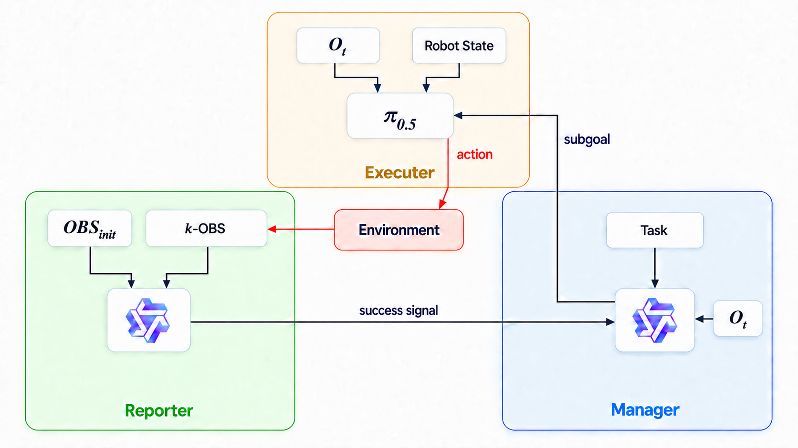

# Trinity

**Base version: Trinity v2.2. Current development branch: Oracle Plus.**

This branch implements the Trinity pipeline for memory-based robot tasks. The
pipeline has three cooperating components: a Manager that predicts the current
subgoal, an Executer that performs the action, and a Reporter that determines
whether the subgoal has completed.

## Version overview

Trinity v0 is the first attempt to divide the system into the three-part
Manager-Executer-Reporter framework. Trinity v2.1 changes the Reporter from a
single current observation to a rolling window of multiple overall-camera
observations. The current Trinity v2.2 builds on the v2.1 temporal input and
adds the wrist-camera view, so every Reporter observation contains an overall
and wrist image pair.

The table below keeps only the best result for each compared version from the
provided experiments.

| Version | Best experiment | Average success rate | Main configuration |
| --- | --- | ---: | --- |
| Baseline | `Baseline_v4` | 0.78 | The VLM Predictor is fine-tuned on a single task; the VLA uses the RoboMME team's released multi-task fine-tuned model. |
| Trinity v0 | `Trinity_v0.7` | 0.80 | Best result from the initial Manager-Executer-Reporter framework; the Reporter uses a single-frame observation and the Executer uses the RoboMME multi-task fine-tuned model. |
| Trinity v2.1 | `Trinity_v2.1.7` | 0.78 | The Reporter uses multiple overall-camera frames instead of judging the current state from only one frame; the best run also uses a Reporter success buffer. |
| Trinity v2.2 | `Trinity_v2.2.1` | **0.84** | `k=3`; each Reporter observation contains paired overall and wrist views. |

Trinity v1 is intentionally omitted from the comparison table. It was a
standalone test of Reporter debounce rather than a directly comparable version.
That debounce behavior has since evolved into the `REPORTER_DEBOUNCE` switch in
`scripts/eval.sh`, so it can be enabled or disabled independently during eval.

For the current v2.2 implementation, the default Reporter prompt is
`dual_view_temporal_v3`: an overall/wrist init pair plus up to three recent
Reporter-call pairs. Manager and Reporter prompts are selected explicitly, and
prompt metadata is written to datasets and evaluation results.
`FRAMEWORK_VERSION` is now an output label; features such as debounce, prompt
version, history size, and the gripper gate are controlled by their own
configuration values.

### Trinity v2.2 architecture



In this diagram, $O_t$ denotes the current-frame **overall observation**.
`OBS` denotes one paired **overall + wrist observation** used by the Reporter:
`OBS_init` is the paired observation captured when the current subgoal starts,
and `k-OBS` is the rolling window of the latest $k$ paired observations. The
current v2.2 configuration uses $k=3$.

## Oracle Plus: 27B VLM high-level action control

Oracle Plus replaces Trinity's Manager, Reporter, and VLA Executer at inference
time with one Qwen3.8-27B VLM. The VLM observes the task goal plus paired
overall/wrist images and returns strict JSON containing `completed`,
`next_subgoal`, an optional target `point=[y, x]`, and optionally a visual
`description`. The VLM does not output a Python function name. A task-specific
keyword matcher deterministically maps the subgoal to a trusted RoboMME MPLib
function, which produces the robot's low-level trajectory.

This implementation deliberately does **not** use `multi_choice`. Each task has
its own prompt, subgoal-keyword mapping, and parameter-binding
adapter. The adapter turns the program-resolved function name and pixel target
into a concrete simulator object. This prevents the model from invoking
arbitrary Python functions or passing fabricated simulator objects.

### Current execution path

```text
task goal + overall/wrist observations
                |
 robomme eval WebSocket client
                |
      msgpack request (image paths)
                |
 robomme-qwen38 Qwen3.8-27B server
                |
 description? + completed + next_subgoal + point (JSON)
                |
 task-specific subgoal keyword matcher
                |
 task-specific validated action adapter
                |
     RoboMME MPLib high-level function
                |
       dense simulator observations
```

The initial call predicts a complete proposed subgoal sequence and its first
subgoal. After execution, each follow-up call compares the pre-action image
pair with up to three recent overall/wrist pairs, judges whether the active
subgoal completed, and either repeats it or advances. Every response is parsed
as JSON; the active subgoal must match exactly one trusted keyword rule before
execution. For grounded actions, the VLM point is expressed as `[y, x]` in the latest overall
image. As in Oracle Planner, RoboMME projects candidate-object world positions
into the image and selects the candidate whose projected center is closest to
the requested point.

### Implemented scope

The new live eval currently supports `BinFill`, because this is the task for
which a special prompt, keyword mapper, and parameter adapter have been added.
The mapper currently resolves to:

- `solve_pickup`, with a required VLM target point matched against all current cubes;
- `solve_putonto_whenhold_binspecial`, bound to the BinFill board/bin;
- `solve_button`, bound to the task button.

RoboMME contains 22 public high-level functions in
`subgoal_planner_func.py`, but they are not all safe drop-in actions: several
are helpers, recovery operations, intentional failures, or require different
object parameters. The remaining 15 tasks must therefore each add a prompt,
an explicit keyword-to-function mapping, and an adapter before they become
selectable. An
unsupported task fails at startup instead of silently falling back to Oracle
choices.

| Component | Oracle Plus implementation |
| --- | --- |
| Model | Qwen3.8-27B FP8 through ms-swift, thinking disabled |
| Model environment | micromamba `robomme-qwen38`; dedicated WebSocket process |
| Evaluation environment | micromamba `robomme`; RoboMME, ManiSkill, SAPIEN, and MPLib |
| Simulator action space | `joint_angle`; trajectories are emitted internally by MPLib |
| Process connection | WebSocket + msgpack, following the existing VLA server/client lifecycle |
| Action selection | Program maps VLM subgoal keywords to a trusted function; VLM emits no action name |
| Description variants | `VLM_INCLUDE_DESCRIPTION=true/false` selects one of two strict prompt/output schemas |
| Target grounding | VLM pixel `[y, x]`; nearest projected candidate object, matching Oracle Planner |
| Views | Current overall + wrist pair; follow-up temporal window uses up to three pairs |
| Current task coverage | `BinFill` only |
| Logs | Prompts, image paths, raw/parsed response, selected function, execution info, final status, eval-process RSS/cgroup OOM counters, other-process/eval GPU memory, VLM single-step latency, and VLM-to-mapped-action request time |

Run the evaluation from the repository root with:

```bash
bash scripts/eval_oracle_plus.sh
```

The launcher uses `/data/public/qwen/Qwen3.8-27B-FP8` by default. It starts
`scripts/serve_oracle_plus_vlm.py` inside `robomme-qwen38`, waits for the
WebSocket port, then runs `examples/robomme/eval_oracle_plus.py` inside
`robomme`. Configure task, episode IDs, repeats, GPU, model path, endpoint,
result name, and `VLM_INCLUDE_DESCRIPTION` at the top of the shell script.
Results are stored under `runs/evaluation/oracle-plus/<run-name>/` as one JSON
record per episode plus `summary.json`; the exact VLM input images are retained
beside each episode log for auditing. The VLM server log is stored under
`runs/evaluation/oracle-plus/server_logs/`.

With `OVERWRITE=false`, rerunning the launcher with the same run name resumes a
partial evaluation: completed repeat/task/episode entries in `episodes.jsonl`
are preserved and skipped, while entries whose latest status is `error` are
retried. `run_config.json` prevents results from different model, prompt, or
evaluation settings from being mixed. Set `OVERWRITE=true` only to delete the
existing run directory and start that run name again from scratch.

During evaluation the terminal shows one global episode progress bar. Detailed
planner output is redirected to `<run-name>/eval.log`. Each task/repeat stores
annotated rollout videos under `videos/`, one complete raw/parsed VLM trace per
episode under `vlm_logs/`, and the exact overall/wrist request images under the
corresponding `episode_XXXX/decision_XXX/` directories. `progress.json` is
updated after every episode; `log.json`, `summary.json`, and `episodes.jsonl`
provide final aggregate and per-episode machine-readable results.

## 1. Build the dataset

The QwenVL builder writes the processed dataset under
`<preprocessed_data_path>/qwenvl/`. The training JSONL files are:

```text
qwenvl/simple_subgoal_train.jsonl
qwenvl/grounded_subgoal_train.jsonl
```

### `data/` and `runs/` layout

All paths below are relative to the repository root. Names in angle brackets
are supplied by the corresponding build, training, or evaluation command.

```text
data/
├── robomme_data_h5/                         # optional local raw RoboMME HDF5 data
│   └── <TaskName>.h5
├── robomme_preprocessed_data/               # Executer training dataset
│   ├── data/
│   │   └── <sample_id>.pkl
│   ├── features/
│   │   └── episode_<episode_id>/
│   │       ├── token_emb_<step>.npy
│   │       └── kept_indices.json
│   └── meta/
│       └── stats.json
└── trinity_preprocessed_data/               # Manager training datasets
    └── <manager_dataset_name>/
        └── qwenvl/
            ├── images/
            │   ├── <TaskName>_ep<episode>_step<step>.png
            │   └── <TaskName>_ep<episode>_video.mp4
            ├── simple_subgoal_train.jsonl
            └── grounded_subgoal_train.jsonl

runs/
├── assets/
│   └── mme_vla_suite/                       # Executer normalization/assets data
├── ckpts/
│   ├── manager/
│   │   └── <manager_run_name>/
│   │       └── <version>/
│   │           └── checkpoint-<step>/       # Manager LoRA checkpoint
│   ├── executer/
│   │   └── <executer_run_name>/
│   │       └── <step>/                      # newly trained Trinity Executer
│   └── mme_vla_suite/
│       └── symbolic-simple-subgoal/
│           └── 79999/                       # legacy rep Executer checkpoint
└── evaluation/
    ├── server_logs/
    └── <executer_name>/
        └── <evaluation_run_name>/             # e.g. trinity_v2.2.2
            ├── summary.json                   # aggregate of all seeds/repeats
            └── seed<seed>/
                └── repeat<repeat_id>/
                    ├── progress.json
                    ├── log.json
                    └── <TaskName>/
                        ├── frames/
                        │   ├── overall/
                        │   │   └── ep<episode_id>/
                        │   │       └── step_<step>.png
                        │   └── wrist/
                        │       └── ep<episode_id>/
                        │           └── step_<step>.png
                        ├── manager_logs/
                        │   └── <TaskName>_ep<episode_id>.log
                        ├── reporter_logs/
                        │   └── <TaskName>_ep<episode_id>.log
                        └── videos/
                            └── <evaluation_video>.mp4
```

During an episode, Reporter also creates
`<TaskName>/init_frames/ep<episode_id>/{overall,wrist}/` for the active init
pair. That episode directory is deleted when evaluation of the episode ends.

### Build all `.h5` files

Omit `--tasks` to process every `.h5` file directly under
`--raw_data_path`:

```bash
uv run python scripts/build_dataset.py \
  --dataset_type manager_qwenvl \
  --raw_data_path /data/public/RoboMME \
  --preprocessed_data_path data/trinity_preprocessed_data/manager_all_data
```

### Build only specified tasks

Use `--tasks` followed by one or more task names. This example processes only
the `BinFill` dataset:

```bash
uv run python scripts/build_dataset.py \
  --dataset_type manager_qwenvl \
  --raw_data_path /data/public/RoboMME \
  --preprocessed_data_path data/trinity_preprocessed_data/manager_binfill_data_1 \
  --tasks BinFill
```

For multiple tasks, list their names separated by spaces, for example:

```bash
--tasks BinFill PickXtimes
```

Add `--visualize` only when visualization MP4s are needed. Keyframe duplicate
training samples are generated whether or not visualization is enabled.

### Build Reporter data

Reporter data uses the same selected frames and transition-frame duplication
as the QwenVL Manager builder. Within each subgoal span, the first observation
is the subgoal start frame. Selected intermediate observations are labelled
`{"success": false}` and the subgoal transition observation is labelled
`{"success": true}`. The terminal episode frame is excluded because the live
Reporter is not called after the environment terminates. Each subgoal owns a
capacity-`k` sliding window containing only Reporter-call observations, not
adjacent raw timesteps. The default is `k=3`. Every observation contains an
overall/wrist pair. The window grows naturally from one pair to three pairs,
then rolls at capacity. It is cleared immediately when the subgoal completes.

```bash
uv run python scripts/build_dataset.py \
  --dataset_type reporter_qwenvl \
  --raw_data_path /data/public/RoboMME \
  --preprocessed_data_path /home/zhuanglr/robomme_pl_for_zhuang/data/trinity_preprocessed_data/reporter_data \
  --reporter_history_size 3
```

The builder writes:

```text
reporter_data/reporter_qwenvl/images/
reporter_data/reporter_qwenvl/images/overall/
reporter_data/reporter_qwenvl/images/wrist/
reporter_data/reporter_qwenvl/simple_subgoal_train.jsonl
reporter_data/reporter_qwenvl/grounded_subgoal_train.jsonl
```

Each JSONL row contains `system`, `user`, and `assistant` messages plus 4, 6,
or 8 images by default: init overall/wrist, followed by one to three
Reporter-call overall/wrist pairs ordered oldest to newest with the current
observation last. The prompt is imported from the same shared module as live
Reporter inference, preventing training/inference prompt drift.

Before training, select the simple or grounded JSONL and GPU settings near the
top of `scripts/finetune_reporter.sh`. `REPORTER_HISTORY_SIZE` must match data
generation; the script validates the first row before starting training.
Then run:

```bash
bash scripts/finetune_reporter.sh
```

To evaluate a trained LoRA, set `REPORTER_ADAPTER_PATH` in `scripts/eval.sh`
to the generated checkpoint directory and keep `REPORTER_HISTORY_SIZE` equal
to the training value. Adapters trained with the old single-view media layout
should not be reused.

### Select the Qwen backbone

Manager/Reporter fine-tuning and evaluation support these local backbones:

- `Qwen3-VL-4B-Instruct`
- `Qwen3-VL-8B-Instruct`

Select one by name; its path is resolved as
`/data/public/qwen/<QWEN_BACKBONE_NAME>`:

```bash
QWEN_BACKBONE_NAME=Qwen3-VL-8B-Instruct bash scripts/finetune_manager.sh
QWEN_BACKBONE_NAME=Qwen3-VL-8B-Instruct bash scripts/finetune_reporter.sh
```

Set `QWEN_BACKBONE_ROOT` to change the common parent directory, or set
`QWEN_BACKBONE_PATH` as an explicit full-path override. Make sure each LoRA
adapter is evaluated with the same backbone size used for its training.

During evaluation, Manager and Reporter are independent. Set
`MANAGER_QWEN_BACKBONE_NAME` and `REPORTER_QWEN_BACKBONE_NAME` separately in
`scripts/eval.sh`; each also has its own `*_ROOT` and optional `*_PATH`
override next to the corresponding Manager or Reporter configuration.

## 2. Train the VLM subgoal predictor with tmux

Before training, set `DATASET_PATH`, `RUN_NAME`, `OUTPUT_DIR`, and, if needed,
`CUDA_VISIBLE_DEVICES` in `scripts/finetune_vlm_subgoal_predictor.sh`.

Create and enter a named tmux session:

```bash
tmux new -s vlm_train
```

Initialize micromamba and activate the `robomme` environment inside that
session:

```bash
micromamba activate robomme
```

Then start training:

```bash
bash scripts/finetune_vlm_subgoal_predictor.sh
```

Detach without stopping training by pressing:

```text
Ctrl-b, then d
```

List running tmux sessions and check whether the training session still
exists:

```bash
tmux ls
```

Enter the training session again:

```bash
tmux attach -t vlm_train
```

If the session is already attached elsewhere, detach it there and attach it
to the current terminal:

```bash
tmux attach -d -t vlm_train
```

After training has finished, the session can be closed from inside it with
`exit`, or from another terminal with:

```bash
tmux kill-session -t vlm_train
```

## 3. Evaluation

Before evaluation, edit the **Evaluation configuration** section near the top
of `scripts/eval.sh`. In particular, check:

- `EVAL_PRESET`
- `EXECUTER_CKPT_ID`
- `EXECUTER_SEEDS` and `NUM_REPEATS`
- `ONLY_TASKS` and `NUM_EPISODES`
- the Manager and Reporter adapter paths
- `MANAGER_PROMPT_VERSION` and `REPORTER_PROMPT_VERSION`
- `MANAGER_QWEN_BACKBONE_NAME` and `REPORTER_QWEN_BACKBONE_NAME`
- `REPORTER_HISTORY_SIZE` (must match Reporter training)
- `EXECUTER_GPU_ID` and `MANAGER_REPORTER_GPU_ID`
- `FRAMEWORK_VERSION`, `RUN_NAME`, and `SAVE_DIR`
- `REPORTER_DEBOUNCE` (`true`/`false`, independent of `FRAMEWORK_VERSION`)
- `REPORTER_GRIPPER_GATE` and its position thresholds when the optional pickup
  verification is enabled

Run the evaluation from the repository root:

```bash
bash scripts/eval.sh
```

The script evaluates every configured seed/repeat pair sequentially. It starts
a fresh policy server for each pair, writes the individual result under
`<SAVE_DIR>/<executer_name>/<evaluation_run_name>/seed<seed>/repeat<repeat>/`,
updates `summary.json` in the evaluation-run directory, and stops the server
automatically. Re-running with `OVERWRITE=false` resumes incomplete episodes.
Each completed run's `log.json`, and its corresponding item in the aggregate
summary's `runs` array, records only the GPU ID, total memory, pre-launch
occupied memory, and that eval's average process memory as one-decimal `GB`
strings. GPU statistics are not averaged across evals, and a GPU metadata
collection failure does not stop evaluation.
